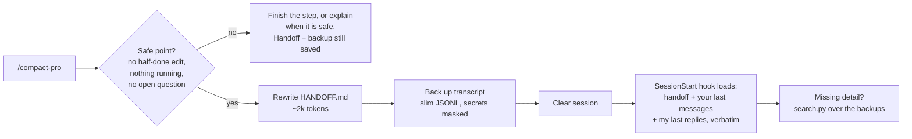

<div align="center">

# compact-pro

**Deep compaction for Claude Code.**
Starts the next session from a ~2k-token handoff, not a 25k–45k-token summary, with every word of the old
session one search away.

[](LICENSE)
[](#install)
[](#requirements)
[](#requirements)
[](https://github.com/PramiCorp/compact-pro/actions/workflows/test.yml)

</div>

---

```text
> /compact-pro

Compact Pro: context 448k -> ~145k tokens (saved ~303k).
/compact would have left ~171k (saved ~277k; it carries ~28k, median of 6 measured /compact runs here).
Compact Pro carries ~2.4k instead: ~26k fewer tokens on every following turn (91% less than /compact).

Saved docs/handoff/HANDOFF.md and session_2026-11-10_a5e4e704.jsonl
(26 MB transcript -> 5 MB, 44 secrets masked). Clearing the session now.
```

## Why

`/compact` summarises the conversation, but the summary stays inside the context. Files, skills and recent
messages are attached again on top of it. On a long working session, that carried-over block is typically
**25k–45k tokens**, and every later turn pays for it until the next compaction, which then comes sooner.

`/compact-pro` keeps the working memory **outside** the context window:

| | `/compact` | `/compact-pro` |
|---|---|---|
| What the next turn carries | Summary + re-attached files, skills and messages | Handoff file + your last words, verbatim |
| Measured carry-over* | **25k–44k tokens** | **1.6k–3k tokens** |
| Exact history | Lost (summary only) | Full transcript backup, searchable for a few hundred tokens |
| Survives the 30-day transcript cleanup | No | Yes (backup lives in your project) |
| Human-readable state | No | `HANDOFF.md`, which you can read and edit |
| Safe to trigger mid-task | Yes, lossily | **Refuses** until a safe point (or `force`) |
| Secrets in the saved history | n/a | Masked |

<sub>*Measured on real Claude Code sessions: the context size of the first reply after each of five built-in
compactions, minus the same session's fixed overhead (system prompt, tools, skills, CLAUDE.md). Compact Pro:
the measured size of its session-start text. The fixed overhead is identical in both cases and isn't
counted.</sub>

**About 22k–41k fewer tokens on every turn** after a compaction, roughly 90–95% of the carried context.
Over a 100-turn stretch that is 2–4M tokens that are never re-read. You also get more room before the next
compaction and a model that isn't steering by a lossy summary.

## How it works



Everything lives in your project:

```text
docs/handoff/
├── HANDOFF.md                         # the next session's starting point (you can read and edit it)
├── session_2026-11-11_a5e4e704.jsonl  # full transcript backup: text kept, images/duplicates dropped, secrets masked
├── history/HANDOFF_2026-11-10_1802.md # every earlier handoff, so a rewrite can always be undone
└── .gitignore                         # keeps the backups out of git
```

### The safety gate

Clearing at the wrong moment destroys working state that no summary keeps. Before it clears,
`/compact-pro` checks:

1. No half-applied change (a red build counts as one).
2. No background command, subagent or workflow still running or awaited.
3. Not waiting on the user's answer or approval.
4. No browser or device flow halfway through.
5. No live debugging thread whose evidence exists only in the conversation.
6. The user isn't iterating on recent output ("make *that* bigger").
7. Fresh corrections are already saved to memory.

If a check fails, it finishes the step when that's a few actions away. Otherwise it saves the handoff and
backup, says exactly when clearing becomes safe, and keeps working. `/compact-pro force` overrides, and first
writes an extra-detailed "In progress" section.

### Nothing is lost, and lookup is cheap

```bash
python search.py <project> export button        # entries containing all words, newest first (~300 tokens)
python search.py <project> --show session_…jsonl:812
python search.py <project> --around session_…jsonl:812 4
python search.py <project> --asks 20            # what the user actually typed
python search.py <project> --list               # every backed-up session at a glance
```

The skill tells Claude to search the backups **before** guessing, asking you again or re-reading large
files.

### Hooks

All hooks do nothing in a project until `/compact-pro` has run there once.

| Event | What it does |
|---|---|
| `SessionStart` (startup, clear) | Loads `HANDOFF.md`, then **Where we left off**: your last 6 messages and the final replies of the last 2 turns, verbatim, so "yes, do it" still makes sense after a clear. |
| `SessionStart` (compact) | After a built-in `/compact`, points Claude at the backup taken a moment earlier. |
| `PreCompact` | Backs up the transcript before **any** compaction, including auto-compact. |
| `SessionEnd` | Backs up the transcript when a session closes. Claude Code deletes its own transcripts after ~30 days. |
| `UserPromptSubmit` | Past 120k tokens of context, reminds Claude once per 40k to *suggest* `/compact-pro` at the next safe point. It never acts on its own. |

## Install

### As a plugin (recommended)

```text
/plugin marketplace add PramiCorp/compact-pro
/plugin install compact-pro@prami
```

Restart Claude Code. Then type `/compact-pro` (or `/compact-pro:compact-pro`).

### Manually

```bash
git clone https://github.com/PramiCorp/compact-pro.git
cd compact-pro && python install.py      # copies the skill to ~/.claude/skills, adds the hooks (settings backed up first)
```

Uninstall with `python install.py --uninstall`. Your handoffs and backups stay where they are.

### Requirements

- Claude Code (CLI, desktop app or IDE extension).
- Python 3.8+ on `PATH` (`python3`, `python` or `py`; the launcher tests each one, so the Microsoft Store
  stub on Windows doesn't fool it).
- `sh`. Claude Code runs hooks through a POSIX shell on every platform; on Windows that is Git Bash.
- No packages, no network, no API keys.

## Usage

| Command | Effect |
|---|---|
| `/compact-pro` | Gate → handoff → backup → clear |
| `/compact-pro force` | Clear even mid-task, after writing a detailed "In progress" section |

Every run ends with a **savings report** measured from your own transcripts (`scripts/report.py`). It gives the
context before and after, what `/compact` would have left (the median of the compactions measured in that
project), and the tokens saved on every later turn.

In the **desktop app** the session clears itself. In the **terminal**, Claude finishes with "Type `/clear`";
the hook does the rest.

### Configuration

| Variable | Default | Meaning |
|---|---|---|
| `COMPACT_PRO_DIR` | `docs/handoff` | Handoff folder, relative to the project root |
| `COMPACT_PRO_NUDGE_AT` | `120000` | Context size at which the reminder starts (`0` turns it off) |
| `COMPACT_PRO_NUDGE_STEP` | `40000` | Growth between reminders |

## Privacy and security

- **Local only.** Nothing is uploaded; the scripts use only the standard library.
- **Secrets are masked** in backups: passwords in links, `password = "…"`-style values, `?password=` query
  values, `Authorization` headers, and common key formats (Anthropic, OpenAI, Google, GitHub, Slack, AWS).
  Booleans and placeholders are kept, so a UI dump's `password="false"` still reads correctly. Text of tool
  calls that *write project files* is kept exactly, since it is in your repository anyway.
- **Masking matches patterns, so it can't catch everything.** A password typed as plain prose ("it's
  hunter2") is kept. Treat backups like the conversation itself.
- Backups are **git-ignored** automatically. The handoff never contains credentials.

## FAQ

**Does it replace `/compact`?** For working sessions, yes. Auto-compact still exists as a safety net, and
compact-pro backs up the transcript before it runs.

**What if the handoff misses something?** Claude searches the backups, which hold every message, tool call and
result. Earlier handoffs are in `history/`.

**Does clearing delete my conversation?** No. Claude Code keeps the original transcript ("Resume previous
session" still works), and compact-pro keeps a slim copy in your project.

**Why not just a bigger summary?** Anything inside the context is re-read on every turn. A file on disk costs
nothing until it is needed, and a search reads only the lines that matter.

## Development

```bash
python -m unittest discover -s tests -v
```

## License

[MIT](LICENSE) © 2026 Prami Corporation
